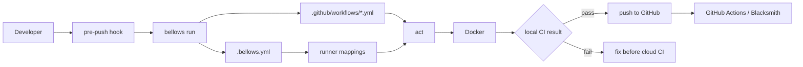

# bellows 🔥🪨

[](https://github.com/smeltery/bellows/actions/workflows/ci.yml)
[](https://github.com/smeltery/bellows/actions/workflows/release.yml)
[](https://polyformproject.org/licenses/shield/1.0.0/)

Bellows runs existing GitHub Actions workflows locally through [act](https://github.com/nektos/act) and Docker. It is designed for repositories that want a fast pre-push check, including teams migrating workflows that use Blacksmith runner labels.

By default, Bellows maps runner labels to [kiln](https://github.com/smeltery/kiln), a hardened, glibc-native [Wolfi](https://github.com/wolfi-dev) `act` runner image published at `ghcr.io/smeltery/kiln`. Override `runner.map` in `.bellows.yml` to use any other act-compatible image.



## Quick Start

```sh
go install github.com/smeltery/bellows@latest

cd your-repo
bellows migrate github-actions
bellows init
bellows doctor --fix
bellows hooks install --stage pre-push
bellows run --list --estimate
```

`bellows init` writes a repo-local `.bellows.yml`. Keep committing your normal `.github/workflows/*.yml` files; Bellows maps them to local Docker images for act.

## Requirements

- Docker or a Docker-compatible local runtime
- `act` available on `PATH`
- Go only when installing from source or with `go install`

Check local dependencies with:

```sh
bellows doctor
```

## Development Environment

Bellows includes a Flox environment with the project toolchain:

- Go
- act
- Docker CLI
- pre-commit
- golangci-lint
- GoReleaser

Activate it before working on the repo:

```sh
flox activate
```

Or run commands directly inside the environment:

```sh
flox activate -- go test ./...
flox activate -- golangci-lint run
flox activate -- goreleaser check
```

## Configuration

Bellows reads `.bellows.yml` from the repository root.

```yaml
version: 1
default_workflows:
  - ci.yml
event: pull_request
runner:
  map:
    ubuntu-latest: ghcr.io/smeltery/kiln:ubuntu-22.04
    macos-latest: ghcr.io/smeltery/kiln:ubuntu-22.04
    blacksmith-4vcpu-ubuntu-2204: ghcr.io/smeltery/kiln:ubuntu-22.04
precommit:
  stage: pre-push
  mode: full
  timeout_seconds: 900
```

The default `runner.map` points at [`ghcr.io/smeltery/kiln`](https://github.com/smeltery/kiln) tags (`ubuntu-22.04`, `ubuntu-24.04`). The package is public, so `act` pulls it without authentication.

See [docs/configuration.md](docs/configuration.md) for the supported fields.

## Commands

| Command | Description |
|---|---|
| `bellows init` | Create `.bellows.yml` for the current repository. |
| `bellows init --dry-run` | Preview generated config without writing files. |
| `bellows init --pre-commit` | Create `.bellows.yml` and add a local pre-commit hook that runs at `pre-push`. |
| `bellows migrate github-actions` | Inspect existing workflows and print a recommended migration plan. |
| `bellows run` | Run configured workflows through act. |
| `bellows run --list` | Show the resolved local execution plan without Docker. |
| `bellows run --list --estimate` | Show runnable, skipped, and avoided cloud job estimates. |
| `bellows run --workflow ci.yml` | Run one workflow from `.github/workflows`. |
| `bellows run --workflow .github/workflows/ci.yml --job test` | Run one workflow job. |
| `bellows run --precommit` | Run the pre-push hook path and print rerun commands on failure. |
| `bellows doctor` | Check Docker, act, workflow compatibility, secrets, and runner mappings. |
| `bellows doctor --format json` | Emit stable diagnostics for automation and agents. |
| `bellows doctor --format github` | Emit GitHub Actions annotations. |
| `bellows doctor --format sarif` | Emit SARIF for code scanning integrations. |
| `bellows doctor --strict` | Fail when warnings are present. |
| `bellows doctor --fix` | Apply safe `.bellows.yml` fixes. |
| `bellows doctor --fix --fix-dry-run` | Preview safe `.bellows.yml` fixes without writing. |
| `bellows doctor --image-preflight` | Check mapped runner image availability. |
| `bellows doctor bundle` | Emit sanitized diagnostics for support and agents. |
| `bellows self-test` | Check this Bellows install and repository. |
| `bellows explain --format json` | Emit the resolved local execution plan as JSON. |
| `bellows explain changed-files` | Show how changed Git files select workflows and jobs. |
| `bellows compat` | Report supported, partial, and unsupported local workflow features. |
| `bellows hooks install --stage pre-push` | Install the generated Bellows pre-push hook. |
| `bellows hooks status --format json` | Report hook installation state for automation. |
| `bellows secrets audit` | Show workflow secret references and local allowlist state. |
| `bellows release check` | Run the local release-readiness suite. |
| `bellows config validate` | Validate `.bellows.yml`. |
| `bellows config upgrade` | Upgrade `.bellows.yml` to the current schema version. |
| `bellows policy` | Check local execution policy. |
| `bellows completion zsh` | Generate shell completions. |
| `bellows cache prune` | Prune Docker builder cache used during local workflow runs. |

## Documentation

- [Quickstart](docs/quickstart.md)
- [Installation](docs/installation.md)
- [Commands](docs/commands.md)
- [Configuration](docs/configuration.md)
- [Compatibility](docs/compatibility.md)
- [JSON Schemas](docs/schemas)
- [Local Differences](docs/local-differences.md)
- [Troubleshooting](docs/troubleshooting.md)
- [Security](docs/security.md)

## Pre-Push Hook

Bellows uses the `pre-commit` framework but defaults to the `pre-push` stage so full workflows do not run on every commit.

```sh
bellows init --pre-commit
pre-commit install --hook-type pre-push
```

Generated hook entry:

```yaml
entry: bellows run --precommit
stages: [pre-push]
```

See [docs/pre-commit.md](docs/pre-commit.md).

## Blacksmith

Bellows maps Blacksmith runner labels to local act images so workflow files can stay unchanged:

```yaml
runner:
  map:
    blacksmith-2vcpu-ubuntu-2204: ghcr.io/smeltery/kiln:ubuntu-22.04
    blacksmith-4vcpu-ubuntu-2204: ghcr.io/smeltery/kiln:ubuntu-22.04
    blacksmith-8vcpu-ubuntu-2204: ghcr.io/smeltery/kiln:ubuntu-22.04
    blacksmith-16vcpu-ubuntu-2204: ghcr.io/smeltery/kiln:ubuntu-22.04
    blacksmith-32vcpu-ubuntu-2204: ghcr.io/smeltery/kiln:ubuntu-22.04
    blacksmith-2vcpu-ubuntu-2404: ghcr.io/smeltery/kiln:ubuntu-24.04
    blacksmith-4vcpu-ubuntu-2404: ghcr.io/smeltery/kiln:ubuntu-24.04
    blacksmith-8vcpu-ubuntu-2404: ghcr.io/smeltery/kiln:ubuntu-24.04
    blacksmith-16vcpu-ubuntu-2404: ghcr.io/smeltery/kiln:ubuntu-24.04
    blacksmith-32vcpu-ubuntu-2404: ghcr.io/smeltery/kiln:ubuntu-24.04
```

Run `bellows doctor` to see which labels are mapped locally. See [docs/blacksmith.md](docs/blacksmith.md).

For workflows with OS matrices, Bellows reports dynamic runner expressions such
as `${{ matrix.os }}` as matrix-dependent diagnostics. `macos-*` labels can map
to Ubuntu-based act images as a local compatibility fallback; this does not
emulate macOS.

## License

Bellows is licensed under the [PolyForm Shield License 1.0.0](https://polyformproject.org/licenses/shield/1.0.0/).
