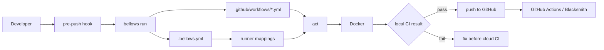

# bellows 🔥🪨

[](https://github.com/dotbrains/bellows/actions/workflows/ci.yml)
[](https://github.com/dotbrains/bellows/actions/workflows/release.yml)
[](https://polyformproject.org/licenses/shield/1.0.0/)

Bellows runs existing GitHub Actions workflows locally through [act](https://github.com/nektos/act) and Docker. It is designed for repositories that want a fast pre-push check, including teams migrating workflows that use Blacksmith runner labels.



## Quick Start

```sh
go install github.com/dotbrains/bellows@latest

cd your-repo
bellows init
bellows doctor
bellows run
```

`bellows init` writes a repo-local `.bellows.yml`. Keep committing your normal `.github/workflows/*.yml` files; Bellows maps them to local Docker images for act.

## Requirements

- Docker or a Docker-compatible local runtime
- `act` available on `PATH`
- Go only when installing from source or with `go install`

Check local dependencies with:

```sh
bellows doctor
```

## Development Environment

Bellows includes a Flox environment with the project toolchain:

- Go
- act
- Docker CLI
- pre-commit
- golangci-lint
- GoReleaser

Activate it before working on the repo:

```sh
flox activate
```

Or run commands directly inside the environment:

```sh
flox activate -- go test ./...
flox activate -- golangci-lint run
flox activate -- goreleaser check
```

## Configuration

Bellows reads `.bellows.yml` from the repository root.

```yaml
version: 1
default_workflows:
  - ci.yml
event: pull_request
runner:
  map:
    ubuntu-latest: catthehacker/ubuntu:act-22.04
    macos-latest: catthehacker/ubuntu:act-22.04
    blacksmith-4vcpu-ubuntu-2204: catthehacker/ubuntu:act-22.04
precommit:
  stage: pre-push
  mode: full
  timeout_seconds: 900
```

See [docs/configuration.md](docs/configuration.md) for the supported fields.

## Commands

| Command | Description |
|---|---|
| `bellows init` | Create `.bellows.yml` for the current repository. |
| `bellows init --pre-commit` | Create `.bellows.yml` and add a local pre-commit hook that runs at `pre-push`. |
| `bellows run` | Run configured workflows through act. |
| `bellows run --workflow ci.yml` | Run one workflow from `.github/workflows`. |
| `bellows run --workflow .github/workflows/ci.yml --job test` | Run one workflow job. |
| `bellows run --precommit` | Run the pre-push hook path and print rerun commands on failure. |
| `bellows doctor` | Check Docker, act, workflow compatibility, secrets, and runner mappings. |
| `bellows cache prune` | Prune Docker builder cache used during local workflow runs. |

## Documentation

- [Quickstart](docs/quickstart.md)
- [Installation](docs/installation.md)
- [Commands](docs/commands.md)
- [Configuration](docs/configuration.md)
- [Troubleshooting](docs/troubleshooting.md)
- [Security](docs/security.md)

## Pre-Push Hook

Bellows uses the `pre-commit` framework but defaults to the `pre-push` stage so full workflows do not run on every commit.

```sh
bellows init --pre-commit
pre-commit install --hook-type pre-push
```

Generated hook entry:

```yaml
entry: bellows run --precommit
stages: [pre-push]
```

See [docs/pre-commit.md](docs/pre-commit.md).

## Blacksmith

Bellows maps Blacksmith runner labels to local act images so workflow files can stay unchanged:

```yaml
runner:
  map:
    blacksmith-2vcpu-ubuntu-2204: catthehacker/ubuntu:act-22.04
    blacksmith-4vcpu-ubuntu-2204: catthehacker/ubuntu:act-22.04
    blacksmith-8vcpu-ubuntu-2204: catthehacker/ubuntu:act-22.04
    blacksmith-2vcpu-ubuntu-2404: catthehacker/ubuntu:act-24.04
    blacksmith-4vcpu-ubuntu-2404: catthehacker/ubuntu:act-24.04
    blacksmith-8vcpu-ubuntu-2404: catthehacker/ubuntu:act-24.04
```

Run `bellows doctor` to see which labels are mapped locally. See [docs/blacksmith.md](docs/blacksmith.md).

For workflows with OS matrices, Bellows reports dynamic runner expressions such
as `${{ matrix.os }}` as matrix-dependent diagnostics. `macos-*` labels can map
to Ubuntu-based act images as a local compatibility fallback; this does not
emulate macOS.

## License

Bellows is licensed under the [PolyForm Shield License 1.0.0](https://polyformproject.org/licenses/shield/1.0.0/).
