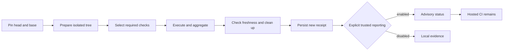

# Advisory verification acceptance audit

**Advisory MVP evidence accepted.** This audit covers Bellows `28eed73`
(the previous release is `v0.3.14`) on 2026-10-29. A merged component and its synthetic tests
do not establish complete parity for a consuming private repository.
All private prerequisite PRs and public user documentation are merged. The
final integrated private profile passed all required checks; the public CI
checkpoint below records the audited Bellows revision.

The agreed release provides advisory local verification while retaining hosted
CI. It neither changes required GitHub contexts nor authorizes merges. Local
hooks are bypassable. A trusted workstation remains trusted; receipt validation
and reporting credentials cannot prove execution by hostile code running as the
same user. See [trust boundaries](design/local-verification.md) and
[trusted reporting](trusted-reporting.md).

## Requirement matrix

The original plan contains 24 requirements, NIC-48 through NIC-71. “Merged”
records available implementation and regression evidence, not a blanket
acceptance of the rollout. Private links require repository access and contain
the detailed evidence; no private source or logs are reproduced here.

| Requirement | Delivery reference | Evidence and remaining scope |
| --- | --- | --- |
| NIC-48: contracts and trust | [PR 8](https://github.com/smeltery/bellows/pull/8), `dc56ada` | Merged. Typed contracts, versioned schema and valid/invalid fixtures agree. Aggregation rejects required skipped, missing, failed and cancelled checks; unresolved inputs remain distinct. |
| NIC-49: Git discovery | [PR 10](https://github.com/smeltery/bellows/pull/10), `cc74b55` | Merged. Temporary Git tests cover committed and mixed local changes, rename endpoints, deletions, unusual paths, unborn HEAD, missing refs, divergence and shallow-history errors. Gitlinks cannot disappear through ignore settings. |
| NIC-50: private baseline | [Private PR 74](https://github.com/smeltery/nightshift/pull/74), `5e800bf` | Merged private inventory and baseline. Its check matrix, platform assumptions, measurements and rollback inventory remain private; this is not evidence that every integration has passed locally. |
| NIC-51: existing hooks | [PR 11](https://github.com/smeltery/bellows/pull/11), `d971d35` | Merged. Synthetic Lefthook exercise propagates failure, preserves existing hooks and handles paths with spaces. Hook bypass is documented. |
| NIC-52: isolated worktrees | [PR 14](https://github.com/smeltery/bellows/pull/14), `149d5c2` | Merged. Dirty-original preservation, merge conflicts, moved refs, cancellation and concurrent worktrees have regression coverage. [PR 23](https://github.com/smeltery/bellows/pull/23) explicitly rejects unmaterialized submodules. |
| NIC-53: conservative selection | [PR 13](https://github.com/smeltery/bellows/pull/13), `013e306` | Merged. Unknown/shared paths select full verification; dependency closure and deterministic reasons are tested. Invalid graphs and empty required plans fail; skipped prerequisites remain visible. Static matrices have bounded expansion; unsupported expressions are rejected. |
| NIC-54: receipts | [PR 12](https://github.com/smeltery/bellows/pull/12), `98c14a9` | Merged. Strict version/schema validation, canonical round trips, identity matching, atomic private storage and concurrent readers/writers are tested. A valid imported receipt is not trusted execution evidence. |
| NIC-55: native Flox executor | [PR 15](https://github.com/smeltery/bellows/pull/15), `2a43223` | Merged. Argv, working directory, credentials, toolchain and cancellation tests; real native Flox fixture in Linux/macOS CI. [PR 24](https://github.com/smeltery/bellows/pull/24) preserves bounded cleanup before escalation. |
| NIC-56: service isolation | [PR 18](https://github.com/smeltery/bellows/pull/18), `4f66c48` | Merged. Real Linux PostgreSQL/Docker fixtures cover concurrent success, failure and cancellation with owned cleanup. Dedicated-daemon lease required; shared-daemon and Docker Desktop parity are not claimed. |
| NIC-57: exact-commit CLI | [PR 19](https://github.com/smeltery/bellows/pull/19), `6942dc3` | Merged. CLI help/JSON and orchestration tests cover prepared execution, conflicts, failures, cancellation, moving refs, complete outcomes and persistence after cleanup. Legacy interactive commands remain. |
| NIC-58: GitHub transport | [PR 16](https://github.com/smeltery/bellows/pull/16), `7e8dcaa` | Merged. Synthetic HTTP tests cover private targets, permissions, bounded retries, redirects, duplicates and stale completion. Transport publishes allowlisted advisory metadata, not raw logs. |
| NIC-59: publication policy | [PR 17](https://github.com/smeltery/bellows/pull/17), `134466c` | Merged. In-process lifecycle capability rejects imported/edited evidence, changed identities/plans and credential overrides. Same-user hostile execution is outside the trust claim. |
| NIC-60: reporting integration | [PR 21](https://github.com/smeltery/bellows/pull/21), `84f1714` | Merged. Fake-HTTP lifecycle covers success and non-success outcomes, freshness and API failure. Explicit opt-in and persisted current-run evidence are required. Live private scratch-PR rollout remains NIC-68. |
| NIC-61: native profiles | [PR 20](https://github.com/smeltery/bellows/pull/20), `346402b` | Merged. Config/schema and end-to-end profile tests cover strict fields, graph validity, explicit executor choice, failure propagation and reproducible identity. Existing package managers remain authoritative. |
| NIC-62: download/layer caches | [PR 26](https://github.com/smeltery/bellows/pull/26), `6fe9556` | Merged. Actual npm cold/warm/corruption evidence and real Linux BuildKit hit/equivalence tests; concurrent leases, bounded pruning and repository binding. Installed dependencies and successful test results are never reused. |
| NIC-63: prepare once | [Private PR 75](https://github.com/smeltery/nightshift/pull/75), `f25ac8b` | Merged. Private preparation identity and regression tests retain independent hosted shard commands. Final consuming profile must run preparation regressions as well as prepared shards. |
| NIC-64: private configuration/hooks | [Private PR 76](https://github.com/smeltery/nightshift/pull/76) | Merged at `b4677e3`; reviewed source was `5af5f46`. Private setup/hooks and the complete profile are reviewed; hosted jobs remain. |
| NIC-65: complete private parity | [Private PR 79](https://github.com/smeltery/nightshift/pull/79), `fd9ee20` | Merged after Linux verification at `9b01273`. Eight required checks passed cold/warm; four injected failures, real cancellation, two concurrent passes, sentinel preservation and owned cleanup are recorded privately. |
| NIC-66: stale advisory results | [PR 25](https://github.com/smeltery/bellows/pull/25), `901c499` | Merged, with current-ref correction in PR 28. Identity/ref movement, superseded attempts, bounded watch and capability tests. Read-only capability reporting never claims merge authorization or changes repository settings. |
| NIC-67: measured performance | [Private PR 80](https://github.com/smeltery/nightshift/pull/80), `cafe6ae` | Merged after verification at `7e91d50`. Complete-coverage measurements and provenance remain private. No avoided hosted cost is claimed while hosted workflows remain enabled. |
| NIC-68: advisory rollout | [Private PR 81](https://github.com/smeltery/nightshift/pull/81), `5081f1d` | Merged after verification at `6b667c2`. Six live advisory cases and real Lefthook adoption/rollback passed; retained hosted triggers and infrastructure limitations are recorded privately. |
| NIC-69: user documentation | [PR 22](https://github.com/smeltery/bellows/pull/22), `28eed73` | Merged after green checks. Public setup, receipt inspection, intentional reporting, stale recovery and permission guidance match shipped commands. |
| NIC-70: acceptance | This audit | Accepted advisory MVP evidence: prerequisites merged, final private integration passed, public validation recorded below. Hosted billing exceptions and trust limitations remain explicit. |
| NIC-71: successful-result reuse | Post-acceptance optimization | Deferred by design. Not implemented or enabled in this release. Requires independent provenance, complete identity/plan invalidation, expiry and failure tests; it must not block the advisory MVP. |

## Original repository improvements

[PR 5](https://github.com/smeltery/bellows/pull/5) established the shared Flox
checks and automated tested releases. The repository has a license, a concise
README with technology/status badges and links into split user documentation,
validated Mermaid diagrams, pinned Bun documentation tooling, and contributor
hooks invoking the same Make targets as CI. Bellows is public and its audited
main CI, release and smoke runs are green. Exact license-content equality was privately confirmed; the local SHA-256 is
`5fce31b74a03790580196c1324b975d086c4281e9f9260123ae63ae09c63be11`.
No source-budget increase is introduced by this report.

## Supporting fixes and private evidence checkpoint

[PR 9](https://github.com/smeltery/bellows/pull/9) (`5e91f6c`, NIC-72)
isolates Git fixture environments in contributor hooks. This prevents temporary
repository tests from inheriting a caller's real index, refs or signing setup.

[Private PR 77](https://github.com/smeltery/nightshift/pull/77) (`76b60b8`,
NIC-73) is merged after review of `65de7a9`. Its engine shutdown fix preserves `CI=true`, uses a
version-matched dependency patch and prevents cancellation from spawning a
replacement process after cleanup. The exact source tree passed the private
14-step verifier and the affected real PostgreSQL integration tests. Hosted
checks were prevented from starting by billing restrictions; they are not
represented as green. The approved private CI exception was recorded before merging.

Private configuration PR 76, parity PR 79, performance PR 80 and rollout PR 81
are merged after review and Linux validation at the revisions above. The required
eight-check profile passed cold and warm runs. Four representative injected
failures, real cancellation and two concurrent full passes were observed, with
sentinel preservation and empty owned-resource cleanup. The private receipt
matrix retains each run's actual source identity; distinct revisions are not
presented as one run.

Each final private commit passed the canonical 14-step verifier. The parity
workstream's five focused tests and the configuration workstream's 18 harness
tests were separate executions, not one combined invocation. Raw receipts, logs,
measurement values and consuming source remain private. Docker Desktop parity
is not claimed; the supported complete-profile evidence is Linux.

[PR 28](https://github.com/smeltery/bellows/pull/28) (`e92c00b`, NIC-74)
fixes a freshness defect discovered during the live advisory exercise: GitHub's
pull-request snapshot could retain an old base SHA after the target branch
advanced. Reporting now resolves both current branch refs and rejects invalid
or inaccessible refs. Private reporting therefore also needs Contents read.
The focused PR passed Linux, macOS and real-service CI plus independent review.

All six live private advisory cases passed with the fixed binary: success,
failure, cancellation, head movement, base movement and post-success base-watch
invalidation. Persisted receipts and exact identities/results were independently
checked. This minimal transport exercise establishes advisory lifecycle behavior;
it does not establish the full private services/shards/images parity matrix.
Real Lefthook adoption/rollback also passed. The rollout record is complete in
merged private PR 81, with applicable private CI exceptions approved.

## Public evidence and invariants

[Main CI run 40975299054](https://github.com/smeltery/bellows/actions/runs/40975299054)
passed on `28eed73`: Linux/macOS release checks and the Linux real-service/cache
job. The previous released code baseline `e92c00b` passed [release](https://github.com/smeltery/bellows/actions/runs/40959003183) and
[smoke](https://github.com/smeltery/bellows/actions/runs/40959357491) checks
for [v0.3.14](https://github.com/smeltery/bellows/releases/tag/v0.3.14), including
archive, Homebrew and Go installation checks.
The shared gate runs Markdown/Mermaid validation, workflow/release validation,
Go lint, race tests, coverage, build and CLI self-checks through Flox.

The following test groups provide reproducible public evidence:

- [Contracts](../internal/verification/contracts_test.go),
  [Git discovery](../internal/changed/git_test.go) and
  [selection](../internal/changed/required_test.go): no empty or incomplete
  required-check success; conservative changes and explicit errors.
- [Worktrees](../internal/verification/worktree/worktree_test.go),
  [orchestration](../internal/verification/run/run_test.go) and
  [receipts](../internal/verification/receipt/receipt_test.go): pinned inputs,
  owned cleanup and persisted truthful outcomes, including negative paths.
- [Policy](../internal/reporting/policy/policy_test.go),
  [session](../internal/reporting/session/session_test.go) and
  [freshness](../internal/reporting/freshness/freshness_test.go): trusted
  lifecycle, explicit reporting and stale-result rejection without live writes
  in unit tests.
- [Service fixture](../internal/verification/actexec/integration_test.go) and
  [Docker cache fixture](../internal/verification/cache/docker_integration_test.go):
  opt-in real Docker tests in the Linux services job. A normal Go test run can
  skip these, so its pass alone is insufficient evidence of service parity.

Measured production size at the audited commit is **6,836 / 7,000** nonblank Go
lines and **30 / 80** custom tooling lines. The reviewed allocation is in
[development](development.md); this documentation change adds no production
code or budget allowance.

## Platforms, timing and retained workflows

Linux and macOS run the public native Flox/release checks. Service verification
requires a dedicated Linux Docker daemon. A macOS client may use an explicitly
provisioned Linux runner, but this does not establish Docker Desktop parity.
Unsupported service expressions, unmaterialized submodules and unsupported
matrix forms remain explicit failures rather than skipped successes.

[Cache measurements](caches.md) establish fixture-level download and layer
behavior only. They do not establish whole-project speedups or portable timing
budgets. Reviewed private end-to-end performance evidence is in private PR 80;
its raw measurements are intentionally not copied here.
Hosted verification is retained, so no hosted workflow retirement or monetary
saving is claimed. Account billing restrictions can prevent hosted jobs from
starting; those runs are not green execution evidence.

Bellows retains its CI, automatic release, release and smoke workflows. The
private consumer retains its hosted lint, shard, engine integration and image
build jobs and their triggers. Adoption must not silently remove an existing
required context or change repository privacy, billing or branch settings.

## Final integration and acceptance

The approved private CI exceptions preceded dependency-ordered merges of PRs
77, 76, 79, 80 and 81. Hosted checks remain enabled; billing restrictions were
recorded separately from the complete local execution evidence. Public user
documentation PR 22 is also merged after green checks.

The exact integrated private head `5081f1d` passed the complete required profile
against base `f25ac8b`, with tree `ee5ea087`. All eight required checks passed,
including configuration harness tests, the canonical verifier, real database and
callback/readiness tests, and both required image builds. The receipt was
persisted, the source remained clean and no owned resources remained. Detailed
identity, receipt and measurement evidence stays in the private archive.

This accepts advisory local verification, not protected merge authority or
universal platform parity. Hosted CI stays enabled and the documented private
billing exceptions do not imply successful hosted execution. Successful-result
caching is not implemented; its separate work starts only after this acceptance
is merged.
