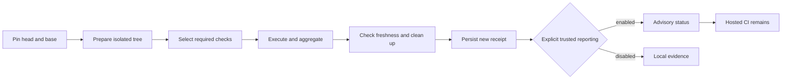

# Advisory verification acceptance audit

**Draft; acceptance remains pending.** This audit covers Bellows `6fe9556`
(released as `v0.3.13`) on 2026-10-29. A merged component and its synthetic tests
do not establish complete parity for a consuming private repository.
The acceptance decision waits for the private rollout (NIC-68) and public user
documentation (NIC-69), including the unresolved evidence below.

The agreed release provides advisory local verification while retaining hosted
CI. It neither changes required GitHub contexts nor authorizes merges. Local
hooks are bypassable. A trusted workstation remains trusted; receipt validation
and reporting credentials cannot prove execution by hostile code running as the
same user. See [trust boundaries](design/local-verification.md) and
[trusted reporting](trusted-reporting.md).

## Requirement matrix

The original plan contains 24 requirements, NIC-48 through NIC-71. “Merged”
records available implementation and regression evidence, not a blanket
acceptance of the rollout. Private links require repository access and contain
the detailed evidence; no private source or logs are reproduced here.

| Requirement | Delivery reference | Evidence and remaining scope |
| --- | --- | --- |
| NIC-48: contracts and trust | [PR 8](https://github.com/smeltery/bellows/pull/8), `dc56ada` | Merged. Typed contracts, versioned schema and valid/invalid fixtures agree. Aggregation rejects required skipped, missing, failed and cancelled checks; unresolved inputs remain distinct. |
| NIC-49: Git discovery | [PR 10](https://github.com/smeltery/bellows/pull/10), `cc74b55` | Merged. Temporary Git tests cover committed and mixed local changes, rename endpoints, deletions, unusual paths, unborn HEAD, missing refs, divergence and shallow-history errors. Gitlinks cannot disappear through ignore settings. |
| NIC-50: private baseline | [Private PR 74](https://github.com/smeltery/nightshift/pull/74), `5e800bf` | Merged private inventory and baseline. Its check matrix, platform assumptions, measurements and rollback inventory remain private; this is not evidence that every integration has passed locally. |
| NIC-51: existing hooks | [PR 11](https://github.com/smeltery/bellows/pull/11), `d971d35` | Merged. Synthetic Lefthook exercise propagates failure, preserves existing hooks and handles paths with spaces. Hook bypass is documented. |
| NIC-52: isolated worktrees | [PR 14](https://github.com/smeltery/bellows/pull/14), `149d5c2` | Merged. Dirty-original preservation, merge conflicts, moved refs, cancellation and concurrent worktrees have regression coverage. [PR 23](https://github.com/smeltery/bellows/pull/23) explicitly rejects unmaterialized submodules. |
| NIC-53: conservative selection | [PR 13](https://github.com/smeltery/bellows/pull/13), `013e306` | Merged. Unknown/shared paths select full verification; dependency closure and deterministic reasons are tested. Invalid graphs and empty required plans fail; skipped prerequisites remain visible. Static matrices have bounded expansion; unsupported expressions are rejected. |
| NIC-54: receipts | [PR 12](https://github.com/smeltery/bellows/pull/12), `98c14a9` | Merged. Strict version/schema validation, canonical round trips, identity matching, atomic private storage and concurrent readers/writers are tested. A valid imported receipt is not trusted execution evidence. |
| NIC-55: native Flox executor | [PR 15](https://github.com/smeltery/bellows/pull/15), `2a43223` | Merged. Argv, working directory, credentials, toolchain and cancellation tests; real native Flox fixture in Linux/macOS CI. [PR 24](https://github.com/smeltery/bellows/pull/24) preserves bounded cleanup before escalation. |
| NIC-56: service isolation | [PR 18](https://github.com/smeltery/bellows/pull/18), `4f66c48` | Merged. Real Linux PostgreSQL/Docker fixtures cover concurrent success, failure and cancellation with owned cleanup. Dedicated-daemon lease required; shared-daemon and Docker Desktop parity are not claimed. |
| NIC-57: exact-commit CLI | [PR 19](https://github.com/smeltery/bellows/pull/19), `6942dc3` | Merged. CLI help/JSON and orchestration tests cover prepared execution, conflicts, failures, cancellation, moving refs, complete outcomes and persistence after cleanup. Legacy interactive commands remain. |
| NIC-58: GitHub transport | [PR 16](https://github.com/smeltery/bellows/pull/16), `7e8dcaa` | Merged. Synthetic HTTP tests cover private targets, permissions, bounded retries, redirects, duplicates and stale completion. Transport publishes allowlisted advisory metadata, not raw logs. |
| NIC-59: publication policy | [PR 17](https://github.com/smeltery/bellows/pull/17), `134466c` | Merged. In-process lifecycle capability rejects imported/edited evidence, changed identities/plans and credential overrides. Same-user hostile execution is outside the trust claim. |
| NIC-60: reporting integration | [PR 21](https://github.com/smeltery/bellows/pull/21), `84f1714` | Merged. Fake-HTTP lifecycle covers success and non-success outcomes, freshness and API failure. Explicit opt-in and persisted current-run evidence are required. Live private scratch-PR rollout remains NIC-68. |
| NIC-61: native profiles | [PR 20](https://github.com/smeltery/bellows/pull/20), `346402b` | Merged. Config/schema and end-to-end profile tests cover strict fields, graph validity, explicit executor choice, failure propagation and reproducible identity. Existing package managers remain authoritative. |
| NIC-62: download/layer caches | [PR 26](https://github.com/smeltery/bellows/pull/26), `6fe9556` | Merged. Actual npm cold/warm/corruption evidence and real Linux BuildKit hit/equivalence tests; concurrent leases, bounded pruning and repository binding. Installed dependencies and successful test results are never reused. |
| NIC-63: prepare once | [Private PR 75](https://github.com/smeltery/nightshift/pull/75), `f25ac8b` | Merged. Private preparation identity and regression tests retain independent hosted shard commands. Final consuming profile must run preparation regressions as well as prepared shards. |
| NIC-64: private configuration/hooks | [Private PR 76](https://github.com/smeltery/nightshift/pull/76) | Pending. Reviewed immutable scope, existing-hook preservation and fresh-checkout setup need the final complete-profile evidence and merge reference. Hosted jobs remain. |
| NIC-65: complete private parity | Private parity evidence, linked from PR 76 | Pending. Full required services/shards/images, cold/warm runs, concurrent runs, injected failures and owned cleanup must all have final-version evidence. Partial shard or engine passes cannot substitute for this matrix. |
| NIC-66: stale advisory results | [PR 25](https://github.com/smeltery/bellows/pull/25), `901c499` | Merged. Identity/ref movement, superseded attempts, bounded watch and capability tests. Read-only capability reporting never claims merge authorization or changes repository settings. |
| NIC-67: measured performance | Private measurement workstream | Pending. Final complete-coverage runs need commit/hardware/cache/repetition provenance, failure timing and measured local latency. No avoided hosted cost is established while hosted workflows remain enabled. |
| NIC-68: advisory rollout | Private scratch-PR rollout | Pending. Live passing, failing, skipped/cancelled and stale advisory outcomes; unchanged hosted triggers/contexts; adoption and rollback exercise; recorded billing and bypass limitations. |
| NIC-69: user documentation | [PR 22](https://github.com/smeltery/bellows/pull/22) | Pending merge. Public setup, receipt inspection, intentional reporting, stale recovery and permission guidance must match shipped commands and pass documentation checks. |
| NIC-70: acceptance | This audit | Pending NIC-68 and NIC-69, complete parity and final release checks. Replace pending references with merged versions and evidence before accepting. |
| NIC-71: successful-result reuse | Post-acceptance optimization | Deferred by design. Not implemented or enabled in this release. Requires independent provenance, complete identity/plan invalidation, expiry and failure tests; it must not block the advisory MVP. |

## Original repository improvements

[PR 5](https://github.com/smeltery/bellows/pull/5) established the shared Flox
checks and automated tested releases. The repository has a license, a concise
README with technology/status badges and links into split user documentation,
validated Mermaid diagrams, pinned Bun documentation tooling, and contributor
hooks invoking the same Make targets as CI. Bellows is public and its audited
main CI, release and smoke runs are green. Exact license-content equality is a
separate private audit check; acceptance still requires its recorded confirmation.
No source-budget increase is introduced by this report.

## Supporting fixes and private evidence checkpoint

[PR 9](https://github.com/smeltery/bellows/pull/9) (`5e91f6c`, NIC-72)
isolates Git fixture environments in contributor hooks. This prevents temporary
repository tests from inheriting a caller's real index, refs or signing setup.

[Private PR 77](https://github.com/smeltery/nightshift/pull/77) (`65de7a9`,
NIC-73) remains in review. Its engine shutdown fix preserves `CI=true`, uses a
version-matched dependency patch and prevents cancellation from spawning a
replacement process after cleanup. The exact source tree passed the private
14-step verifier and the affected real PostgreSQL integration tests. Hosted
checks were prevented from starting by billing restrictions; they are not
represented as green. Merge approval and the final consuming-profile evidence
remain separate requirements.

The private onboarding agent reported a complete cold run with all eight
required profile checks passing on the supported rootful Linux runner. The
previous callback-networking failure was resolved on that runner. A later
revision adds owned-volume cleanup; its exact warm replay is still in progress.
Independent failure-injection, concurrent-run and cancellation evidence remains
pending in NIC-65. These checkpoint summaries do not replace the final private
receipt matrix, which retains each run's distinct source identity.

## Public evidence and invariants

[Main CI run 40912041059](https://github.com/smeltery/bellows/actions/runs/40912041059)
passed on `6fe9556`: Linux/macOS release checks and the Linux real-service/cache
job. Release and smoke runs also passed for
[v0.3.13](https://github.com/smeltery/bellows/releases/tag/v0.3.13).
The shared gate runs Markdown/Mermaid validation, workflow/release validation,
Go lint, race tests, coverage, build and CLI self-checks through Flox.

The following test groups provide reproducible public evidence:

- [Contracts](../internal/verification/contracts_test.go),
  [Git discovery](../internal/changed/git_test.go) and
  [selection](../internal/changed/required_test.go): no empty or incomplete
  required-check success; conservative changes and explicit errors.
- [Worktrees](../internal/verification/worktree/worktree_test.go),
  [orchestration](../internal/verification/run/run_test.go) and
  [receipts](../internal/verification/receipt/receipt_test.go): pinned inputs,
  owned cleanup and persisted truthful outcomes, including negative paths.
- [Policy](../internal/reporting/policy/policy_test.go),
  [session](../internal/reporting/session/session_test.go) and
  [freshness](../internal/reporting/freshness/freshness_test.go): trusted
  lifecycle, explicit reporting and stale-result rejection without live writes
  in unit tests.
- [Service fixture](../internal/verification/actexec/integration_test.go) and
  [Docker cache fixture](../internal/verification/cache/docker_integration_test.go):
  opt-in real Docker tests in the Linux services job. A normal Go test run can
  skip these, so its pass alone is insufficient evidence of service parity.

Measured production size at the audited commit is **6,788 / 7,000** nonblank Go
lines and **30 / 80** custom tooling lines. The reviewed allocation is in
[development](development.md); this documentation change adds no production
code or budget allowance.

## Platforms, timing and retained workflows

Linux and macOS run the public native Flox/release checks. Service verification
requires a dedicated Linux Docker daemon. A macOS client may use an explicitly
provisioned Linux runner, but this does not establish Docker Desktop parity.
Unsupported service expressions, unmaterialized submodules and unsupported
matrix forms remain explicit failures rather than skipped successes.

[Cache measurements](caches.md) establish fixture-level download and layer
behavior only. They do not establish whole-project speedups or portable timing
budgets. Final private end-to-end performance evidence is pending NIC-67.
Hosted verification is retained, so no hosted workflow retirement or monetary
saving is claimed. Account billing restrictions can prevent hosted jobs from
starting; those runs are not green execution evidence.

Bellows retains its CI, automatic release, release and smoke workflows. The
private consumer retains its hosted lint, shard, engine integration and image
build jobs and their triggers. Adoption must not silently remove an existing
required context or change repository privacy, billing or branch settings.

## Evidence still required before acceptance

1. Merge the private onboarding and any narrowly required parity fixes, then
   record the exact versions used by the complete required-check matrix.
2. Confirm the final private revision after the supported rootful Linux runner
   resolved the observed service callback/networking difference. One complete
   cold run passed all eight required checks on an earlier revision; the exact
   final warm replay remains pending. Do not combine different source identities
   into one final-version pass.
3. Preserve private evidence for cold/warm complete runs, independent concurrent
   attempts, representative lint/shard/database/image failures, cancellation
   and cleanup. Explain any supported-platform limitation explicitly.
4. Complete the live advisory scratch-PR and rollback exercise. Confirm hosted
   CI is still attempted and record infrastructure restrictions separately from
   execution failures. Do not certify direct UI/API merge enforcement.
5. Merge public user documentation, rerun final integrated checks, update this
   matrix and make the acceptance decision. Successful-result caching remains
   outside that decision.
