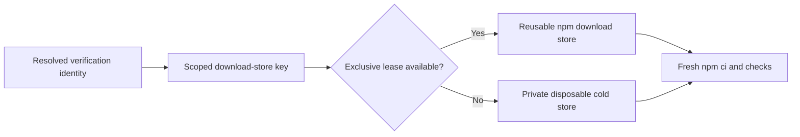

# Reusing downloads and Docker layers

Verification always installs dependencies and executes its checks. Bellows never
caches `node_modules`, successful test results, receipts, or publisher credentials.
Its optional native cache adapter points npm at a private download store using
`npm_config_cache`; npm logs are disabled for that store. npm validates cached
content and refetches corrupt data when online. See the [npm cache documentation](https://docs.npmjs.com/cli/cache/).

## Use the cache

Opt in for a committed native profile:

```sh
bellows verify --repository example/project --base origin/main \
  --profile native --download-cache
bellows verify --repository example/project --base origin/main \
  --profile native --cold-cache
```

Both flags require `--profile`. `--cold-cache` creates a disposable empty store
without requiring `--download-cache`. Reusable stores live under the private user
cache directory at `bellows/downloads`. Cold and warm operation have the same
semantic environment fingerprint; temporary filesystem paths are not included.
Docker verification automatically binds its dedicated daemon to the repository,
and rejects these npm-cache flags rather than claiming a cold Docker run.

## Scope and concurrency

The key includes repository, execution platform, toolchain fingerprint and
dependency fingerprint. Every identity field must be resolved before opening a
store. Changing a commit alone does not discard unchanged downloads; changing the
repository, platform, dependency lock or toolchain creates another store.

`Dependencies(preparedRoot)` hashes committed paths and Git blob IDs for npm
manifests, lockfiles and `.npmrc` across workspaces. It ignores source-only edits,
untracked files and installed `node_modules`; gitlinks invalidate conservatively,
and symlink dependency inputs are rejected. Secret configuration contents never
appear in its output. This is a download-cache scope, not test-result identity:
receipts still require the complete Git tree, config and other input fingerprints.
Local `file:` dependencies are freshly installed, never restored from this cache.



Only one run uses a reusable entry at a time. Another run falls back to a private
cold store rather than waiting or sharing partially updated state. Missing or
unsafe cache metadata also falls back to a disposable store. Root directories
must be private and cannot be symlinks. These controls prevent accidental reuse
between repositories; they do not isolate hostile programs running as the same
operating-system user.

`cache.Open(root, identity, cold)` returns a lease. Append its `Env()` entries to
the native execution environment, and compose `Close()` with executor cleanup.
`State()` reports `cold`, `reuse`, `busy` or `corrupt`; `reuse` means an existing
store was available, not that npm found every requested package in it. Operational
cache paths do not replace semantic input fingerprints.

The CLI calls `Prune(root, 32, 7*24*time.Hour)` before opening a reusable native cache to
keep at most 32 inactive owned entries and
expire inactive entries older than seven days. Active leases are excluded.
Pruning never deletes unrelated paths or follows a cached directory symlink.
A crashed process can leave a lease; an operator must confirm the process ended
before removing that lease. Bellows does not break leases based on age alone.
Disposable stores are deleted on close; interrupted process cleanup remains the
operator's responsibility.

## Cold runs and Docker

An explicit cold npm run always gets a new disposable store. It never reads or
writes a reusable store. There is no restoration of installed dependencies.

Container npm-cache reuse is unsupported without an explicit mount interface.
Bellows does not mount a workstation cache into an unrelated daemon or create a
cache service. Docker's built-in BuildKit cache remains inside the dedicated
Linux daemon described in [services](services.md).

Before reusing Docker layers, call `BindDaemon(root, executor.DaemonID(), repo)`.
The immutable binding rejects reuse by another repository, including another
endpoint that resolves to the same daemon. It does not prove the daemon is new.
A cold Docker run requires a freshly provisioned owned daemon; an arbitrary
existing daemon cannot claim cold parity from an empty filesystem binding record.
The cache adapter never prunes Docker resources. Destroy only the daemon you own
when its retention period ends, then remove its binding record.

## Reproduce the measurements

The npm fixture serves one synthetic tarball from a loopback HTTP server and uses
an integrity-pinned lockfile. It installs into a new project directory each time:

```sh
flox activate -- env BELLOWS_NPM_INTEGRATION=1 \
  go test -v ./internal/verification/cache -run TestNPMColdWarmAndCorruption
```

Observed on macOS arm64 with Node v20.9.0/npm 10.8.2:

| Run | Elapsed | Tarball downloads | Result |
| --- | ---: | ---: | --- |
| Cold | 300.5 ms | 1 | `42` |
| Warm, offline | 220.9 ms | 0 | `42` |
| Corrupted, offline | Not compared | 0 | Explicit `ENOTCACHED` failure |
| Online repair | 240.2 ms | 1 | `42` |

An explicit cold bypass fetched the tarball again. These single-run timings
measure this small local fixture, not a hardware-independent speedup or production
benchmark. The offline warm run and request count provide the cache-hit evidence.

With privileged Docker available, run the BuildKit fixture:

```sh
flox activate -- env BELLOWS_SERVICE_INTEGRATION=1 \
  go test -v -timeout 15m ./internal/verification/cache \
  -run TestDockerCacheIntegration
```

It creates one owned DinD daemon, builds a synthetic scratch image cold and warm,
checks identical image IDs and a `CACHED` build step, rejects cross-repository
binding, and verifies no containers, volumes or custom networks remain. The shared
Ubuntu service CI job runs this fixture alongside concurrent service lifecycle
tests. Docker Desktop cache parity remains unmeasured.
