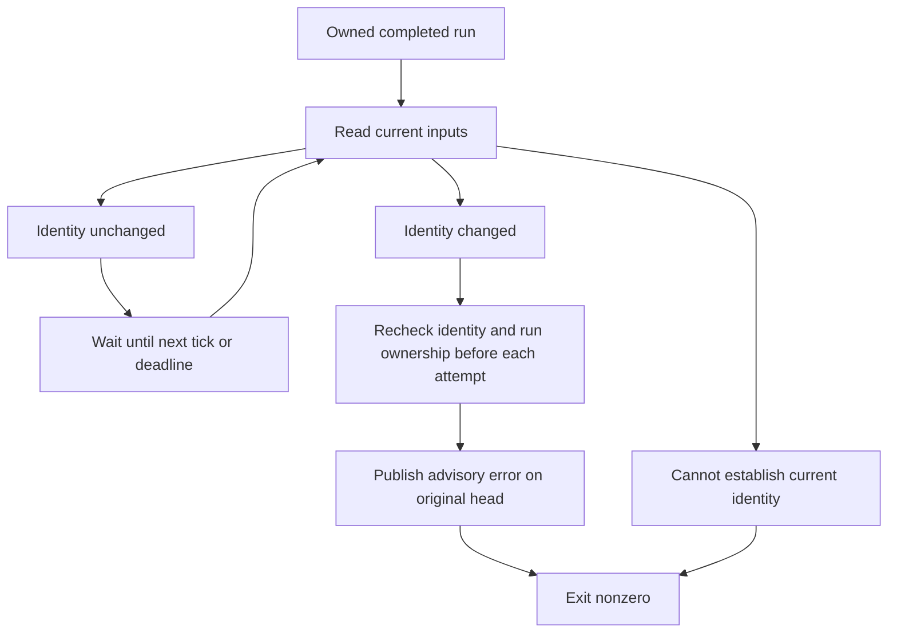

# Advisory freshness

Bellows reports local observations and retains hosted CI. It never authorizes a
merge. A GitHub commit status belongs to a head commit; advancing the base does
not automatically expire an earlier success.

## Bounded observation

Add `--watch-advisory 5m` to an explicitly trusted `verify --report` invocation to
observe its completed run for up to five minutes. The default is zero; the maximum
is one hour. The watcher shares the publisher's current-identity resolver and
checks immediately, then every five seconds. It compares head, base, merge tree,
repository, executor, platform, and every configuration/toolchain fingerprint.



Staleness can only downgrade `bellows/verify` to `error` on the original run's
head. A retry rereads inputs and checks process-local ownership again. It never
uploads imported success evidence or changes a different commit's status. The
CLI returns nonzero and an `error` outcome if observation fails; the immutable
receipt still records the original historical result.

An unavailable lookup fails observation without inventing a newer identity. The
old remote status may remain visible after a network failure. Once the bounded
watch ends, no process continues monitoring. Run verification again for new
evidence; there is no background daemon or custom merge queue.

GitHub provides no compare-and-swap for commit statuses. Independent publishers
can race, and an older watcher can overwrite a newer advisory status with an
error. The process-local ownership guard cannot serialize other machines or
prevent a ref changing between its lookup and HTTP write. It never establishes
that hostile code executed honestly.

## Capability inspection

```sh
bellows verify capabilities --repository owner/project --branch main --format json
```

This explicit command makes read-only calls to GitHub's
[branch protection endpoint](https://docs.github.com/en/rest/branches/branch-protection?apiVersion=2026-03-10)
and [branch rules endpoint](https://docs.github.com/en/rest/repos/rules?apiVersion=2026-03-10).
`BELLOWS_REPORT_TOKEN`, when set, stays in this publisher process. Ordinary local
verification without reporting makes neither of these calls.

| Response | Observation | What it does not establish |
| --- | --- | --- |
| 200 | API is readable | Effective required checks, strict freshness, or bypass coverage |
| 403 | Access or plan restriction | Whether the cause is token permissions or account capability |
| 404 | Absent or not visible | Whether protection is absent or hidden from this identity |
| Other/error | Unavailable or unknown | Any enforcement guarantee |

Every result reports `mode: advisory` and `merge_authorized: false`, including
HTTP 200. Bellows does not inspect these responses deeply enough to certify an
enforcement policy. Direct GitHub UI/API merges remain outside its control;
existing hosted checks and independently configured GitHub rules still apply.
Do not configure the advisory local status as a replacement for those checks.

## Rollback

Omit `--watch-advisory` to stop post-run observation. Omit `--report` and remove
the reporting token from the invocation to stop optional status publication.
No branch rules, required contexts, CI triggers, billing, or visibility settings
are changed by either command, so no repository-setting rollback is required.
