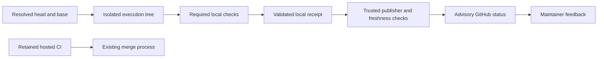

# Local verification contract

Status: accepted interface for implementation; execution and publication are
separate follow-up changes. The initial delivery is **advisory local
verification with hosted CI retained**. A local pass does not authorize a merge.

## Identity and preparation

`internal/verification` owns the shared Go types. The
[receipt v1 schema](../schemas/verification-receipt.schema.json) defines their
serialized shape. Synthetic examples live in
`internal/verification/testdata`; no private repository data belongs there.

`Identity.Head` is the resolved source commit, `Base` the resolved target-branch
commit, and `Tree` the exact tree tested. In `merge` mode, the tree represents the
proposed merge of head into base; it is not the head SHA or necessarily a durable
merge commit. Failed preparation cannot invent a resulting tree or fingerprints: a
non-ready receipt uses empty strings for unresolved identity fields. Only ready
receipts require complete object IDs and all input fingerprints. In `head` mode, the tree belongs to head, but base still identifies
the comparison used to select checks. Git object IDs are full lowercase SHA-1 or
SHA-256 values. Repository identity is a credential-free `owner/repo` slug.

Resolve references once for preparation and retain their object IDs. Original
checkout changes may coexist with verification of committed code: only the
isolated tree is executed. `dirty` means that the prepared execution tree no
longer matches its recorded identity, not merely that the developer's original
checkout has edits. `conflict`, `stale`, and `error` distinguish failed merge
preparation, changed inputs/references, and other invalid preparation.

The fixed fingerprint fields contain lowercase SHA-256 digests:

| Field | Inputs covered |
| --- | --- |
| `workflow` | Selected workflow definitions and local action implementations |
| `config` | Effective verification profile and execution options |
| `policy` | Required checks, exclusions and reporting trust policy |
| `dependencies` | Dependency manifests, lockfiles and pinned action/image identities |
| `toolchain` | Flox lock and resolved compiler/runtime versions |
| `environment` | Declared nonsecret environment inputs that affect results |

Hash canonical content, with sorted paths/keys and explicit absent-input markers.
Never fingerprint raw credential values: low-entropy hashes may disclose them.
If an undeclared or secret input materially affects a check, mark its result
ineligible for cache reuse rather than pretending the fingerprint is complete.
The later receipt/cache implementations own canonicalization and reuse checks.
`Platform` records the actual target OS/architecture; `Executor` is `act` or
`flox`. Results from different modes, platforms or executors are not equivalent.

## Checks, execution and aggregation

`Check` contains a unique stable ID, `Required`, and prerequisite IDs in `Needs`.
Use workflow/job/matrix-discriminator IDs for expanded matrix jobs. Selection
owns dependency closure and rejects unknown prerequisites and cycles before
execution. An explicit policy may classify checks optional; absence must not do
so. No-required-check plans are unsupported for a passing advisory result.

```go
Run(context.Context, verification.Request) (verification.Result, error)
```

`Executor` runs one prepared check. `Request` carries the isolated worktree,
run ID, immutable identity, selected check, argv or workflow/job selector,
an explicit static `Matrix` selector, environment and local output writers.
Workflow adapters must execute only the selected matrix combination, and reject
unresolved/dynamic selectors rather than running every expansion. Native commands use argv without
an implicit shell; workflow execution uses the existing act adapter. The
executor rejects options inappropriate for its mode instead of guessing.
Cancellation comes from context; the executor owns its process tree and
run-scoped resources. It must not mutate the original checkout or shared inputs.

`Env` is the complete explicit child-environment policy, not an instruction to
append unrestricted process environment. Implementations add only documented
runtime necessities and allowed verification secrets. Reporting credentials
never reach a child process, container, log, or receipt. Output writers refer to
local logs; private log content is not part of the transport contract.

`Result` records the check ID, state, nullable exit code and nonnegative duration
in milliseconds. A command can pass only after observed exit code zero. A nil
exit code means no normal command exit was observed. Setup errors, missing
executables, unsupported capabilities and interruptions remain explicit states.
An execution error must not be discarded by orchestration: synthesize an error
result for that check, preserving local diagnostics.

`Evaluate` aggregates a **validated** plan and its results. It rejects non-ready
inputs, duplicate/unknown result IDs, malformed pass results and absent required
results. Required failure, pending, cancellation, unsupported execution or skips
cannot yield `passed`; neither can a missing/pending prerequisite. Optional
failures remain visible but do not override passed required checks. There is no
serialized overall-success flag to trust instead of recomputing aggregation.

## Receipt lifecycle and compatibility

New runs write receipt v2; strict decoding still accepts v1 without changing its
canonical content or digest. Only v2 permits an optional result `reuse` object:
original receipt digest, run ID, completion time and expiry. Reused results are
passed with exit zero and zero execution duration in the new run. UTC times must
identify an earlier completed run whose entry was valid when this run started.
An imported receipt, including its provenance fields, never authorizes reuse.

Native reuse requires explicit check eligibility and an authenticated local
entry bound to the complete ordered plan, inputs and producer binary. Every
invocation creates a new run and receipt. Admission requires all checks to pass,
fresh identities, pristine inputs, successful cleanup and receipt persistence.
An in-process seal exposes only freshly executed eligible results; cache hits
cannot renew their original expiry. Cache errors warn and execute the check.

Receipts contain a schema version, run ID, UTC `started_at`/`completed_at`, input
state, full identity, selected checks and observed results. Use RFC 3339 UTC
strings ending in `Z`; `completed_at` is null while a run is incomplete. Terminal
receipts require a completion time not earlier than their start. Arrays encode
as arrays, including empty prerequisite lists, rather than null.

The schema checks structural shape. The receipt package must additionally
validate graph semantics, identity/digest values, timestamp ordering, terminal
states, duplicates and receipt completeness before persistence or reporting.
The conflict fixture intentionally has no resulting tree or fingerprints.
The synthetic duplicate/missing-result fixtures are deliberately structurally
valid but semantically unsuitable for a passing result. The contract tests
compare schema fields and enums to Go types and exercise fail-closed aggregation;
they do not replace the receipt package's strict decoder/validator.

Persistence owns canonical encoding, atomic writes and bounded private artifact
storage outside tracked source. Unknown versions or fields fail explicitly;
changing required fields or their meaning requires a new schema version and an
explicit migration. Extend the contract in a reviewed prerequisite PR rather
than allowing each consumer to invent extra fields.

## Advisory reporting and future enforcement



The initial issuer is an explicitly trusted maintainer workstation. A dedicated
publisher with a GitHub App identity is an operational alternative, not an MVP
service to build. A receipt digest or signature identifies content or a signer;
it does not prove an untrusted producer actually ran tests. Imported success
JSON alone cannot authorize publication. The publisher needs trusted run
provenance, an allowlisted repository and an explicit operator request.

Treat repository code as executable untrusted input even on a trusted
workstation. Environment filtering does not turn a host process into a security
sandbox: same-user processes and a Docker socket may reach host resources. Do
not execute hostile contributions with publisher credentials accessible on the
machine. Stronger isolation requires separate execution/publishing identities
and an appropriately isolated runtime; the CLI must not promise that boundary.

Re-read the PR's current head and base immediately before publication. A
mismatch invalidates the evidence. A head-only GitHub status does not expire
when the base advances; an advisory status is therefore historical feedback,
not an enforced proof of the current proposed merge. Hooks can also be bypassed.
Retain hosted CI and describe this limitation in status summaries and setup docs.

If enforcement is enabled later, capability detection must verify repository
plan/permissions and a strict up-to-date branch/merge policy, including expected
head checks and the accepted status issuer. An explicit helper does not prevent
UI/API bypass. When those capabilities cannot be established, report advisory
mode and retain existing CI/protections. The private reference repository's
protection/ruleset APIs returned a plan-related 403 during initial discovery;
no enforcement claim or settings change follows from these contracts.

## Ownership and handoff

| Component | Owns | Consumes |
| --- | --- | --- |
| Worktree preparation | Git identity and isolated tree lifecycle | Identity contract |
| Change selection | Required check graph and selection reasons | Resolved Git changes |
| Receipt storage | Strict validation, encoding, private artifacts | Receipt/schema/aggregation |
| act and Flox adapters | Check execution, resources, output | Request/Result interface |
| Verify command | Preparation, selection, execution, terminal aggregation | Component APIs |
| Reporting | Trusted provenance, freshness, sanitized GitHub status | Validated receipt |

These are narrow interfaces, not a new workflow interpreter, scheduler, remote
execution service or cache server. Existing Bellows commands are unchanged by
this contract-only delivery. Downstream PRs can implement independent packages
against the fixtures; shared type/schema changes must land first.
