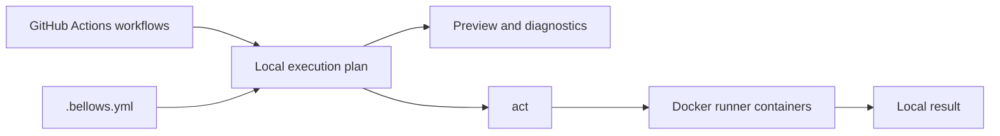
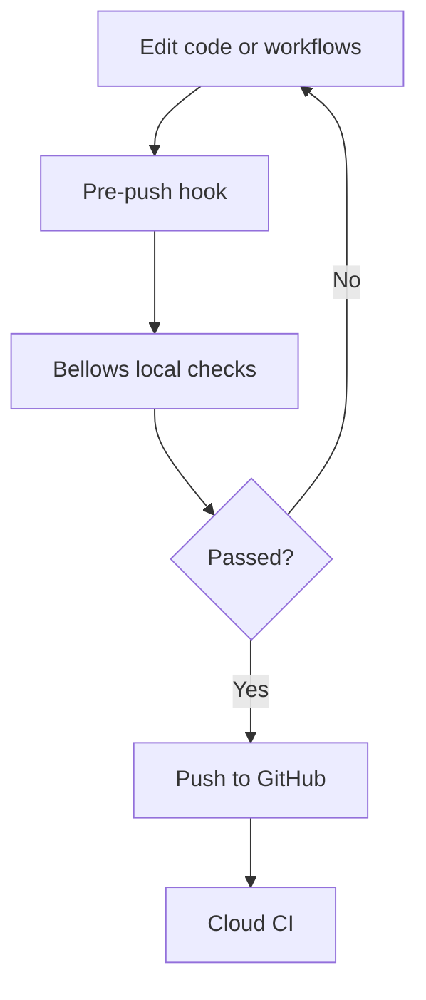

# How Bellows works

Bellows reads GitHub Actions workflow files and `.bellows.yml`, resolves a local
execution plan, then calls act to run jobs in Docker containers.

## Plan before running

Use `bellows run --list --estimate` to inspect jobs and skipped work without
starting Docker. `bellows doctor` checks dependencies and compatibility;
`bellows explain --format json` exposes the plan to other tools.
See [commands](commands.md) for the full interface.

## Runner mappings

Runner labels map to container images through `runner.map`. Blacksmith labels
can use the same local image as Ubuntu jobs. Mapping a macOS label to a Linux
image does not emulate macOS: native platform checks still belong in cloud CI.
See [compatibility](compatibility.md) and [local differences](local-differences.md).

## Catch failures before pushing

Install a hook using the [pre-commit guide](pre-commit.md). Local checks execute
repository code with access to the Docker runtime; run trusted workflows and
pass only required secrets. See [security](security.md) and [secrets](secrets.md).
