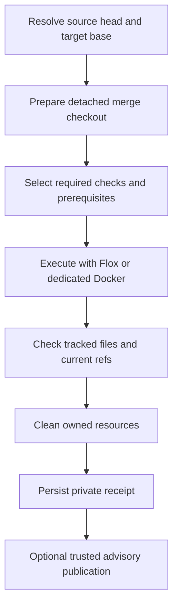

# Verify committed changes locally

Bellows supports private repositories without uploading their source for local
verification. Keep hosted CI for the checks and enforcement your repository
requires. Local receipts and the optional `bellows/verify` status are advisory.

## Choose an executor

Use [native Flox profiles](native-profiles.md) for existing project commands.
Use the [dedicated Docker executor](services.md) to verify supported GitHub
Actions jobs with services. `bellows run` remains useful for interactive workflow
feedback; `bellows verify` records the exact committed inputs it tests.



## Set up a native project

Commit a Flox environment and its lock file alongside `.bellows.yml`. A minimal
profile can reuse an existing project verifier:

```yaml
version: 1
profiles:
  local:
    executor: flox
    checks:
      verify:
        argv: [npm, run, verify]
```

Keep the project's package manager and lock file. For a monorepo, express a
preparation check and prerequisites explicitly; only reuse build outputs when
the project's preparation command validates their source and toolchain identity.
The [Go/web monorepo example](../examples/monorepo-native.yml) verifies a Go
module and an npm project in `web/`, with an explicit install prerequisite. Its
Flox environment must provide both Go and Node. Adapt commands to the scripts
your repository already supports.

Every profile check is required. Arguments are literal; shell interpretation
requires an explicitly configured shell command.

Fetch the target branch, then verify the committed source:

```sh
git fetch origin main
bellows verify --repository example/project --base origin/main --head HEAD \
  --profile local --format json
```

The default mode tests the proposed merge. `--mode head` tests only the source
commit. Uncommitted edits in the original checkout are excluded. The prepared
checkout contains the committed files even when the source checkout is sparse.
Git submodule inputs are currently unsupported and are rejected.
Use the platform the project supports: a Linux container does not establish
native macOS behavior, and a macOS run does not establish Linux service parity.

For repeated native runs, add `--download-cache` to reuse scoped npm downloads,
or `--cold-cache` to use an empty disposable npm store. These controls do not
reuse test results. See [cache behavior](caches.md) for retention, concurrent runs
and Docker build-layer boundaries.

## Read the result

JSON output includes the receipt and its private artifact path. Check logs stream
to stderr. The receipt records repository, head, base, tested tree, executor,
platform, fingerprints, required checks and individual results.

A successful run requires all required checks and prerequisites to pass.
Conflicts, moved refs, changed tracked files, skipped or unsupported checks,
cancellation, cleanup errors and persistence failures prevent success. A receipt
validates the recorded data; it does not independently prove who ran the checks.

Receipts stay outside the execution checkout. Keep them private, especially for
private repositories. Compare the full identity when inspecting or reusing
results; a green status attached to a head SHA does not expire when the target
base branch advances.

## Publish deliberately

See [trusted reporting](trusted-reporting.md) for explicit workstation opt-in,
token permissions, live PR identity checks and a private scratch-PR procedure.
No publication occurs by default. Repository code runs with the local user's
trust; neither native execution nor a Docker socket provides a security boundary
against hostile code running as that user.

For a read-only view of enforcement API availability:

```sh
bellows verify capabilities --repository example/project --branch main --format json
```

Private repositories need an appropriately authorized `BELLOWS_REPORT_TOKEN`.
A 403 can reflect access or plan restrictions; a readable API is not proof that
strict checks apply to every merge path. See
[advisory freshness](design/advisory-freshness.md) for bounded monitoring and
post-run stale-result handling.

[Pre-push hooks](pre-commit.md) provide early feedback and can be bypassed.
GitHub permissions and required checks determine hosted merge enforcement.
An advisory helper cannot prevent direct UI or API merges.

## Recover from a failed run

- Resolve merge conflicts or fetch an advanced target branch, then run again.
- For missing tools or unsupported behavior, follow the executor's diagnostics;
  retain hosted checks for coverage the local executor cannot establish.
- For a dirty dedicated daemon, inspect its resources before operator cleanup.
  Bellows retains its lease instead of deleting unexplained resources.
- For publication errors, keep the local receipt and inspect permissions and live
  PR inputs. Rerun verification when head, base or relevant toolchain changes.
- To roll back adoption, remove the added hook and omit reporting options. Keep
  hosted workflows and required checks in place.
