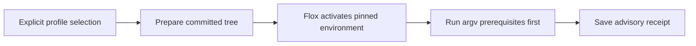

# Native Flox verification profiles

Use a named profile to run existing project checks directly through a committed
Flox environment. This is opt-in: existing workflow verification still uses
`act`, and hosted CI remains unchanged.

## Configure checks

Commit `.flox/env.json`, `.flox/env/manifest.toml`, and
`.flox/env/manifest.lock`, together with a profile in `.bellows.yml`:

```yaml
version: 1
profiles:
  native:
    executor: flox
    checks:
      format:
        argv: [bun, run, format:check]
      test:
        argv: [bun, test]
        needs: [format]
```

Use the commands your project already has; no package-manager migration is
required. Every declared check is required. Prerequisites run first, and failed
prerequisites cause dependent checks to be skipped. Skipped required checks do
not count as success. Profiles reject empty check sets, missing commands,
unknown fields, unknown prerequisites, duplicates, and dependency cycles.



`argv` is an argument list, not an implicit shell program. Variables, globbing,
pipes, and command substitutions remain literal arguments. If a project needs
a shell script, name that script and its interpreter explicitly. Native checks
run trusted project code on your workstation; they do not receive publisher
tokens or automatically gain service isolation. Keep `secrets.mode: none`.

## Run a profile

```sh
bellows verify --repository example/project --base origin/main --profile native
```

Choose either `--profile` or the workflow executor's `--daemon`, never both.
The profile comes from the prepared committed tree, so commit configuration and
script changes before verifying them. The original checkout can retain local
edits. `--mode head` remains an explicit alternative to the default proposed
merge tree; use `--format json` for structured results.

A receipt records the native executor and host platform. Its configuration and
policy fingerprints include the selected profile name, even if two profiles
have identical commands; the toolchain fingerprint includes the committed Flox
lock and installed Flox version. Fresh identity checks reread the host Flox
version and fingerprint `PATH`, `HOME`, and `TMPDIR`, while retaining the
immutable committed configuration and lock after worktree cleanup. Results
from a different profile, executor,
platform, or inputs are not interchangeable. All checks run for the selected
profile; workflow path filters do not omit native required checks.

See [security](security.md) and [local differences](local-differences.md) for the limits of workstation evidence.

On cancellation, native checks receive SIGTERM and have up to five seconds to
release owned resources before Bellows kills the remaining process group.
Commands that manage services should handle that signal and await their cleanup.
