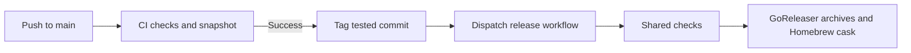

# Releases

## Automatic patch releases

A successful push CI run on `main` triggers an automatic patch tag. The workflow
uses the exact tested commit, skips stale runs, and reuses a tag on retry.
The first version is `v0.1.0`; subsequent versions increment the patch number.
Manual major or minor tags remain supported.



The explicit workflow dispatch is required because tags pushed using
`GITHUB_TOKEN` do not start another push workflow. The release workflow accepts
only stable version tags and checks out that tag. A per-tag concurrency group
prevents overlapping publication runs. Publication explicitly dispatches the
installation smoke tests, including archive checksum verification.

## Credentials and recovery

The automatic tagger needs `contents: write` and `actions: write`. Release
publication uses `GITHUB_TOKEN` and `HOMEBREW_TAP_TOKEN` for the existing tap.
Configure the latter as a repository secret with access to the tap repository.

If publication fails, rerun the release workflow with the existing tag input;
do not move a published tag. The scheduled release check and pull-request
snapshot build catch packaging failures without publishing.

```sh
flox activate -- make release-check
```

Snapshot artifacts are written to `dist/` and excluded from Git.
