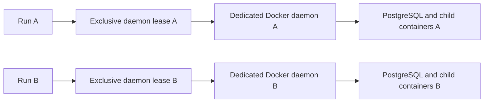

# Local services and Docker

Reproducible service verification requires a dedicated Linux Docker daemon for
one Bellows executor. A normal shared Docker Desktop or workstation daemon is not
an isolation boundary. Existing `bellows run` behavior is unchanged; the dedicated
executor is an internal interface for verification orchestration.

## Why a separate daemon?

[act v0.2.88 derives container names from workflow and job names](https://github.com/nektos/act/blob/v0.2.88/pkg/runner/run_context.go#L67-L104).
Its service networks derive from the same names and override `--network`.
Consequently, separate worktrees, `GITHUB_RUN_ID`, or an extra network flag do not
prevent concurrent runs from colliding. Renaming a workflow changes its GitHub
context, so Bellows does not rewrite user workflows to simulate isolation.



## Executor contract

`actexec.New` accepts an explicit daemon endpoint and an existing private lease
directory shared by all local Bellows agents. The daemon must have no containers,
volumes, or custom networks. The exclusive lease uses Docker's daemon ID, so two
endpoint aliases cannot bypass it. A stale lease requires operator investigation;
Bellows does not guess whether another process is alive or remove its resources.
Only trusted operators may supply endpoints. An exclusive filesystem lease does
not prevent an unrelated Docker client from using that daemon.

Call `Toolchain` with all job-container and service images after pulling them.
It records act/Docker versions and local image IDs, pins runner mappings to IDs,
and checks the recorded images immediately before and after execution. No image
is pulled implicitly. Caller fingerprints must also cover workflow/config/policy
and dependencies. Actions must reference a full commit SHA. Actions and shell
commands still run trusted code with network access: downloaded dependencies,
Docker builds and remote services require their own pinned inputs. This boundary
is not proof that arbitrary network-dependent workflows are reproducible.

`Run` accepts the selected workflow, job and exact static matrix. Conditional,
reusable, absent and empty jobs report unsupported. Reporting tokens and execution
control variables cannot enter the child environment. Explicit allowed variables
use a temporary private environment file, removed after execution; configured
secret names are passed by name and use act's secret masking.

Call `Close` after execution. act receives `--rm`; cancellation sends an interrupt
before a bounded forced stop. Bellows verifies that the daemon is empty afterward.
It precreates act's known `act-toolcache` volume with its lease-owner label and
removes only that exact volume after checking the label. It never prunes Docker
resources or deletes unexplained container IDs. Leftovers
produce an error and retain the lease. The operator must then dispose of the owned
daemon, inspect the failure, and remove its stale lease. This also covers hard
process termination. Ordinary success releases only the executor's own temporary
cache and lease.

## Run the synthetic parity test

With a Docker daemon that permits privileged DinD containers:

```sh
flox activate -- env BELLOWS_SERVICE_INTEGRATION=1 \
  go test -v -timeout 15m ./internal/verification/actexec \
  -run TestDedicatedDockerIntegration
```

The fixture creates three owned DinD containers with dynamically assigned ports
and runs success, failure and interruption cases concurrently. Inside each daemon,
PostgreSQL uses dynamic ports and a readiness probe. The job checks service DNS,
SQL, child Docker execution and Linux host-network reachability. Cleanup targets
only the exact outer container IDs created by the test, including failure paths.
The fixture contains only synthetic credentials and no private project content.

act v0.2.88 did not populate `job.services.postgres.ports[5432]` in the real
fixture. The synthetic job resolves its dynamic port through Docker inspect;
workflows depending on that GitHub context require adaptation and cannot claim
unchanged parity. The executor does not rewrite their expressions.

The Ubuntu CI service job runs this test. macOS/Docker Desktop parity has not been
measured; a missing local Docker daemon is an explicit limitation, not a passing
parity result. Hosted verification remains enabled.
