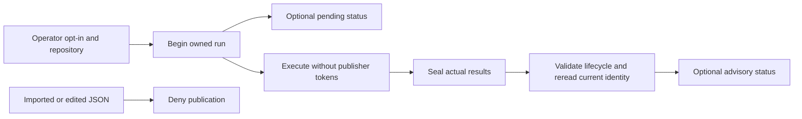

# Trusted advisory reporting

Local reports are optional feedback from an explicitly trusted maintainer
workstation. Keep hosted CI and existing required checks. A local success does
not prove remote execution or authorize a merge.

## Trust and lifecycle

The reporting policy requires operator opt-in bound to one `owner/repo`.
Repository configuration cannot grant that trust. Trusted orchestration creates
a process-local run before execution, binding its run ID, start time, exact
identity, and required-check graph. It seals the actual terminal receipt once.
A new run in that session supersedes the previous one.



Every publication attempt, including a network retry, checks the owned run,
canonical receipt, repository, and freshly resolved head, base, tree, mode,
executor, platform, and all input fingerprints. Success additionally requires
complete ready inputs and passing required checks. Completed failures and errors
can be reported honestly; they cannot be relabeled as success. Missing identity
resolution or a changed lifecycle denies publication with an explicit reason.

With explicit native result reuse, trusted orchestration may include locally
authenticated prior pure-check computation in a new owned run. The receipt
records that provenance; required prerequisites, fresh identity, cleanup, and
persistence still gate success. This does not turn imported JSON into an
authorized reporting lifecycle. See [result caching](caches.md#reuse-pure-native-results).

An imported JSON receipt is useful local evidence but has no process-local run
capability. Edited receipt copies cannot alter sealed evidence. These safeguards
prevent accidental imports and stale or mismatched reports. They do not stop
malicious trusted application code from calling lifecycle APIs with invented
results. Only the trusted orchestration path may call `Begin` and `Complete`;
never expose either as an import-and-publish route.

## Publisher credentials

Keep the publication credential in the reporting process. Build child process
environments from an explicit allowlist and call `policy.CheckExecutorEnv` on
all executor overrides, including explicitly requested secrets. It rejects
`BELLOWS_REPORT_TOKEN`, `GH_TOKEN`, `GITHUB_TOKEN`, `GH_ENTERPRISE_TOKEN`, and
`GITHUB_ENTERPRISE_TOKEN`; an explicit override does not permit forwarding a
publisher credential. The helper does not sanitize inherited process state or
arbitrary differently named secrets, so passing `os.Environ()` remains invalid.
The orchestration integration must enforce both rules before starting any child.

For commit statuses, use a fine-grained token restricted to the intended
repository with **Commit statuses: write**. Add no administration, workflow,
contents-write, or checks permission merely to publish statuses. Separate
read-only discovery permissions may be needed by a different client. GitHub
lists the endpoint's required permission in its
[permission reference](https://docs.github.com/en/rest/authentication/permissions-required-for-fine-grained-personal-access-tokens).

Give the token an expiration, keep it out of tracked files and artifacts, and
revoke it in GitHub's personal access token settings when disabling reporting
or after suspected exposure. Remove local credential copies and opt-in too;
revocation does not erase previously published advisory statuses. See GitHub's
[token management guide](https://docs.github.com/en/authentication/keeping-your-account-and-data-secure/managing-your-personal-access-tokens).

## Workstation limitations and future isolation

The workstation and its operator are trusted. Same-user processes, accessible
credential stores, shared Git metadata, and the Docker daemon are not isolated
by these APIs. Cryptographic signing on that host would authenticate a key,
not prove that untrusted code actually passed verification. Keep private source,
logs, and artifact paths private; publication should contain only allowlisted
metadata.

A future dedicated publisher could use a narrowly installed GitHub App and
receive constrained run evidence from an isolated executor without exposing its
installation token to tests. It would need authenticated run assignment,
freshness checks, credential rotation, and an explicit executor trust model.
This is an operational alternative, not an implemented daemon or a reason to
remove hosted CI or weaken branch protection.

## Publish an advisory run

Local verification performs no GitHub writes by default. To publish a new run,
set `BELLOWS_REPORT_TOKEN` in the invoking environment and add these explicit
options to `bellows verify`:

```sh
bellows verify --repository example/project --base origin/main --head HEAD \
  --daemon unix:///path/to/dedicated/docker.sock \
  --report --trust-workstation --pull-request 123
```

The token needs commit-status write, pull-request read and Contents read permissions for the
selected repository. It stays in the publisher process and is excluded from
verification subprocess environments. Never pass it as a command argument or
commit it to repository configuration.

Bellows resolves both current branch refs before each status attempt rather than
trusting potentially stale pull-request snapshot SHAs. Missing, inaccessible or
inconsistent refs reject publication; the [Git reference endpoint](https://docs.github.com/en/rest/git/refs#get-a-reference)
requires Contents read permission for private repositories.
Only an open pull request within the selected repository is supported. It posts
`bellows/verify` pending before execution and a terminal advisory status after
cleanup and receipt persistence. A changed head/base, invalid lifecycle,
unpersisted receipt, or API error fails publication; no merge is performed.
Local verification results remain available when terminal reporting fails.
The GitHub status is advisory and cannot automatically expire when a base branch
moves. Keep hosted CI and reverify against the current base before merging.

For a private scratch check, use a disposable branch and pull request in a
repository you control. Run once successfully, once with a failing check, and
once while advancing the base. Confirm the separate advisory context and that
the stale run cannot publish success. Close the scratch pull request afterward;
this procedure does not change required checks or billing settings.

The transport uses GitHub's documented
[pull-request inputs](https://docs.github.com/en/rest/pulls/pulls?apiVersion=2026-03-10)
and [commit statuses](https://docs.github.com/en/rest/commits/statuses?apiVersion=2026-03-10).
